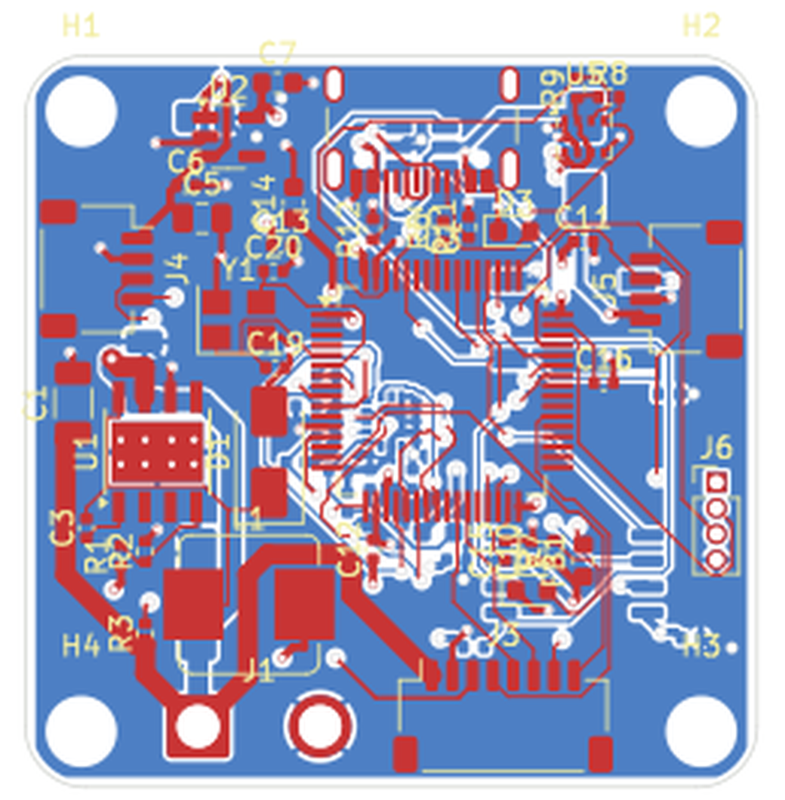

# Worked example: a drone flight controller, from idea to routed board

This is what a new project looks like with RL PCB. Every step below is a real tool call. `design_session.py`
and `board_session.py` are the exact sequence the copilot runs, so you can replay it.

**Brief:** a 5-inch-quad flight controller, 36×36 mm, 30.5 mm M3 mounting, 2–6S LiPo input, Betaflight-style pinout.

| Stage | What RL PCB did | Result |
|---|---|---|
| Requirements → architecture | Recorded requirements + decisions in the plan: STM32F405 (the Betaflight/INAV reference MCU), TPS5430 buck 5 V/3 A → AP2112K 3.3 V LDO, IMU on its own ferrite-filtered rail, SIG/GND/PWR/SIG stackup | `.rlpcb/plan.json` |
| Parts | 61 parts, all from the stock KiCad libraries (symbol + footprint pin counts checked) | 0 invented parts |
| Numbers | Feedback divider 9.31 k/3.01 k → 4.998 V; crystal loads 2·(12−3) = 18 pF; VBAT divider 10 k/1 k → 25.2 V reads 2.29 V; buck L ≈ 13.4 µH → 15 µH, Isat > 3 A | shown with formulas |
| Plan review (ERC before drawing) | Power pins, floating inputs, output conflicts, decoupling, no-connects | **0 errors, 0 warnings** |
| Placement (schematic) | 4 hierarchical sheets (Power / MCU / Sensors / Connectors); each IC placed with its passives beside the pins they serve. **No wires.** | `img/1_schematic_mcu_sheet.png` |
| Wiring guide | Per net: power symbols for rails, global labels for nets that cross sheets, shortest wire order for the rest (e.g. *"Draw a wire from U1.8 (PH) at (78.74, 45.72) to C3.2 at (93.98, 40.64)"*) | step list |
| Verify | Hand-drawn schematic vs plan | 100 % of 174 connections; KiCad's own netlister agrees (79/79 nets) |
| Mistake detection | Swapped SDA/SCL on the baro, and a label dropped 0.64 mm short of a pin | *"Planned nets I2C1_SCL, I2C1_SDA are connected together…"*, *"global label 'SPI1_MISO' is not attached…; nearest pin is U4.4 (SAO/SD0) 0.64 mm away"* |
| Stackup + net classes | 4 layers (density 5 parts/cm², USB 90 Ω); 6 net classes, 32 patterns written to `.kicad_pro` | |
| Board placement | You (or the copilot) place ~20 anchor parts from the plan's layout notes; `placement_suggestions` puts the 40 passives next to the pins they serve (MCU decoupling one cap per VDD pin, load caps at the crystal, pull-ups at the pin), 22 parts on the bottom side | 0 courtyard overlaps; a second pass is a no-op |
| Autoroute (Freerouting, 3 min) | Routes a *copy* of the board | 88–91 % routed across runs, 0 clearance errors from routing; 17–22 connections left for you |
| DRC | Remaining errors are all footprint-inherent: 0.5 mm-pitch LGA pads vs the 0.2 mm default clearance (set Default clearance to 0.15 mm, since JLC allows 0.1), the USB-C's own NPTH tabs, and one via 0.03 mm too close to the edge | |

## What *you* still do (by design)

1. **Draw the wires.** RL PCB never draws them. Follow the wiring guide, then say "verify".
2. **Press F8** (Update PCB from Schematic). In the cloud demo, `make_board.py` stands in for F8.
3. **Route the critical nets by hand before autorouting:** the buck hot loop (C1–U1–D1), the switch node,
   USB D+/D−, and the IMU SPI. Then lock them, autoroute the rest, and finish the last ~10 % by hand.
4. **Read the datasheet sections the copilot points at.** In this design:
   - ICM-20602 RESV pins: the symbol marks them reserved, but check the datasheet for any that must be tied to GND or VDDIO.
   - SMAJ28A: this library symbol names its pins A1/A2, so the plan uses pin numbers. Confirm the cathode faces VBAT.
   - SRP7028A-150M: confirm Isat ≥ 3 A. (L1 was downsized from a 12.5 mm part so it fits on a 36 mm board.)
   - USB-only power: 5 V can back-feed the VBAT rail through the TPS5430 high-side body diode when no battery is
     connected. Many flight controllers accept this; add a diode or load switch if your ESC must stay unpowered.

## Finishing the board (fabrication-ready)

The autorouted copy above still had open connections, so the board was finished for manufacture:

1. **Design rules set for JLCPCB 4-layer**: 0.13 mm default clearance (0.15 mm power/analog, 0.2 mm VBAT), 0.15 mm
   signal tracks, 0.4 mm power, 1.0 mm VBAT, 0.6/0.3 mm vias (0.5/0.3 mm around the IMU), 0.3 mm copper-to-edge.
2. **Freerouting with In1 (GND) and In2 (+3V3) as planes only**: the bottom GND pour was left out of the router's
   input, because the router treated it as a plane and left bottom-side GND pads "connected" to islands that do not
   exist once KiCad fills the pour. Three passes (14 + 8 + 7 min on 2 cores) left 5 connections.
3. **`rlpcb.pcb.finish`** (new) closed the rest with KiCad's own geometry and DRC after every step:
   plane stitching (stub + via from a pad to its plane), a 4-layer grid router with vias, rip-up and retry, and a
   negotiated-congestion router (PathFinder-style) for the two knots: the IMU's SPI fan-out under the MCU, and the
   BMP280 corner. Dangling stubs and an edge-violating via were removed; the USB-C shield pads connect solid.

Result (`output/rl_fc_f405/rl_fc_f405.kicad_pcb`, KiCad DRC): **0 errors, 0 unconnected pads**, 239 pad-to-net
assignments identical to the plan. Remaining warnings: 52 silkscreen overlaps, 22 silk over copper, 2 silk at the
board edge (cosmetic; the fab clips silk on pads), and library-path notices from the machine it was routed on.
71 short segments run on the inner plane layers (41 on In1, 30 on In2) — check the GND return path under the IMU
SPI lines if you care about the last dB of noise.



Manufacturing files are in `output/rl_fc_f405/fab/`: Gerbers + drill (+ drill map) for the 4 copper layers,
`positions.csv`, and `jlcpcb/` BOM + CPL with LCSC numbers. Five BOM lines have no LCSC number on purpose:
J1 (battery pads) and J6 (SWD pads) are not assembled; L1 (SRP7028A-150M), R2 (3.01 k 1 %) and Y1 (8 MHz 3225,
CL = 12 pF to match the 18 pF load caps) must be picked at order time or supplied.

## Replay it

```bash
python examples/drone_fc/design_session.py  C:\work            # plan, review, sheets, placement, wiring guide
python examples/drone_fc/design_session.py  C:\work --labels   # demo only: simulate a finished drawing
# open C:\work\rl_fc_f405 in KiCad, wire it (or use --labels), press F8, save
python examples/drone_fc/board_session.py   C:\work\rl_fc_f405 --route
```

Or just ask in the chat panel / Claude Desktop: *"Design a 30.5 mm flight controller with an F405, ICM-20602,
BMP280, blackbox flash and a 2–6S input"*. The copilot runs these same tools and stops to ask you at each decision.

## The generated project

`output/rl_fc_f405/` is the result of the replay, saved in KiCad 7 format (KiCad 8/9/10 upgrade it when you open it).
It contains:

- the 4-sheet schematic with pin labels (the simulated drawing);
- `rl_fc_f405.kicad_pcb`, the finished, routed board (DRC clean);
- `rl_fc_f405.placed.kicad_pcb`, the placed board before routing;
- `fab/`, the manufacturing files;
- `.rlpcb/plan.json`, the design plan, so you can open the project and ask RL PCB about any part or net.
